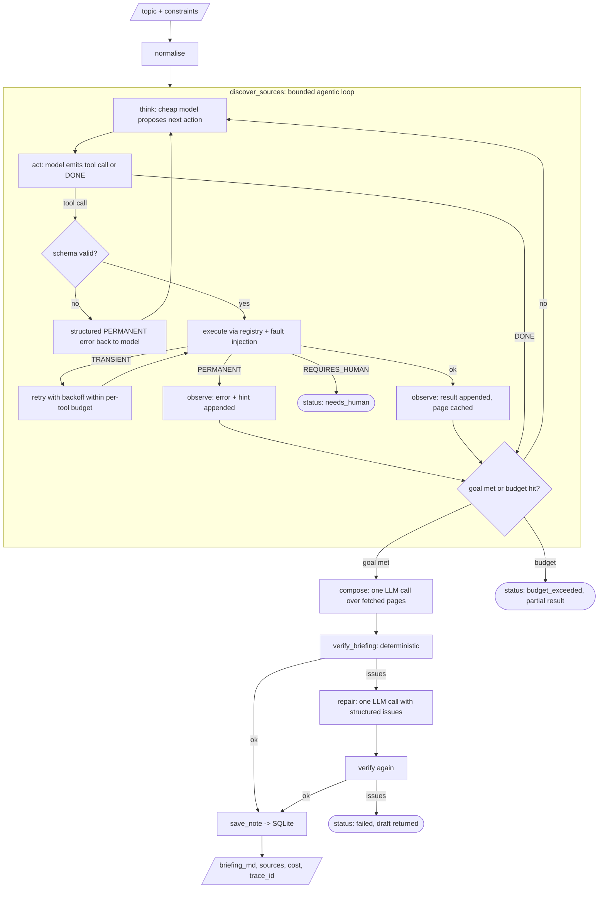

# briefing-agent

A research-briefing agent that owns one real multi-step task end to end: given a topic, it
finds and reads sources, writes a cited Markdown briefing, **verifies every citation against
the pages it actually fetched**, saves the result, and reports what it cost. The loop is
hand-written (`think -> act -> observe -> verify`), bounded by iterations, tool calls and a
dollar cap, checkpointed per step so a run can be resumed, and evaluated on trajectories, not
just final answers.

Everything runs offline with `LLM_PROVIDER=fake` (a scripted policy over recorded Wikipedia
fixtures), so tests, CI and the demo never need a key. Set `OPENROUTER_API_KEY` to run the
same code against a real model. Tracing, pricing and the CI gate come from the sibling project
[`llm-evalops`](../llm-evalops).

```
$ uv run briefing "Consistent hashing"
  think  | Have 0/3 sources. Next: search Wikipedia for 'Consistent hashing'.
  act    | search_wikipedia: Searching 'Consistent hashing'.
  observe| search_wikipedia -> ok (attempts=1)
  think  | Have 0/3 sources. Next: fetch https://en.wikipedia.org/wiki/Consistent_hashing
  act    | fetch_page: Fetching Consistent hashing.
  observe| fetch_page -> ok (attempts=1)
  ...
  goal_met | fetched=3
  verify | ok=True issues=[]
# Briefing: Consistent hashing
## Summary ...
## Key facts
1. ... [1]
## Sources
[1] Consistent hashing — https://en.wikipedia.org/wiki/Consistent_hashing
---
status=ok run_id=2be8f0e06e2f tool_calls=6 llm_calls=9 cost=$0.0576 latency=128ms faults=0
```

## The problem

"Write me a briefing on X" is the archetypal LLM task that looks easy and ships badly: the
model invents a source, cites page 3 for a claim that lives on page 7, loops on a failing
fetch, or quietly spends ten dollars. The interesting engineering is not the prompt; it is
the harness around it: what the model is *allowed* to do, what happens when a tool fails,
when the loop stops, how you know the output is faithful, and how you know a prompt change
did not make things worse.

## The design decision up front: workflow or agent?

A fixed workflow (prompt chaining, routing, parallel fan-out) beats an agent whenever the
sequence of steps is known before you start. It is cheaper (no planning tokens), faster,
testable stage by stage, and cannot loop. An agentic loop earns its cost only where the
*next step depends on what the last step observed* and the branching factor is too large to
enumerate.

In this task exactly one stage has that property: **source discovery**. Which query to run,
which result to fetch, what to do after an empty search or a 404, whether two sources are
enough; none of that is known up front. Everything else is a function with a known input and
a known output:

| stage | kind | why |
|---|---|---|
| normalise input | fixed | pure data shaping |
| **discover sources** | **agentic loop (bounded)** | observation-dependent branching; recovery from tool failures |
| compose briefing | fixed, one LLM call | input (pages) and output (Markdown) are fully specified |
| verify | fixed, deterministic | must not be able to hallucinate |
| repair (at most once) | fixed, one LLM call | input is the verifier's structured failure |
| save note | fixed tool call | side effect, no decision |

The code is structured that way: [`pipeline.py`](src/briefing_agent/pipeline.py) is a plain
sequence of stage functions; only [`agent/loop.py`](src/briefing_agent/agent/loop.py)
lets the model choose actions, and it does so with two tools, a target, and a budget.

## Architecture



Every box emits a span to `traces/spans.jsonl` (shared schema with the other portfolio
repos), and the state is checkpointed to `checkpoints/<run_id>.json` after every iteration
and stage, so `uv run briefing --resume <run_id>` continues from the last step.

## Tools: a public API with poka-yoke schemas

Five keyless tools, all registered through one
[`ToolRegistry`](src/briefing_agent/tools/registry.py):

| tool | does | notable constraints |
|---|---|---|
| `search_wikipedia(query, limit, lang)` | MediaWiki search API | `query` 2..200 chars, single line; `limit` 1..10; `lang` enum `["en"]` |
| `fetch_page(url, max_chars)` | fetch + HTML-to-text (BeautifulSoup, reference markers and math stripped) | `url` must match `^https://[a-z]{2,3}\.wikipedia\.org/wiki/[^\s#?]{1,200}$`; `max_chars` 500..20000 |
| `verify_briefing(briefing, threshold)` | deterministic verifier (below) | `threshold` 0..1 |
| `save_note(topic, markdown, sources)` | SQLite notes store | `markdown` >= 50 chars; `sources` 1..20 unique `{title, url}` with the same URL pattern |
| `list_notes(limit)` | newest first | `limit` 1..100 |

Every schema has `additionalProperties: false`, bounded integers, enums for closed sets and
`minLength` on free text. Validation runs **before** execution
([`registry.validate`](src/briefing_agent/tools/registry.py)); a bad call never reaches the
implementation and comes back to the model as a structured `PERMANENT / invalid_arguments`
error with the exact violation.

**Poka-yoke example.** These calls cannot be expressed, so there is nothing to defend
against at runtime:

```jsonc
// rejected: "does not match pattern" — internal hosts, file URLs and arbitrary sites are not fetchable
{"name": "fetch_page", "arguments": {"url": "http://localhost:8080/admin"}}
{"name": "fetch_page", "arguments": {"url": "file:///etc/passwd"}}
// rejected: "50 is greater than the maximum of 10" — no 10,000-row searches
{"name": "search_wikipedia", "arguments": {"query": "bloom filter", "limit": 50}}
// rejected: "Additional properties are not allowed ('pages')" — misspelled args fail loudly
{"name": "search_wikipedia", "arguments": {"query": "bloom filter", "pages": 3}}
```

The fake provider has a `misbehave="bad_call"` knob that emits the `limit: 50` call first; the
trajectory test asserts the rejection, the structured error, and the corrected second call.

## Failure taxonomy and policy

Every tool error carries `kind`, `code`, `retryable`, `retry_after_ms` and a `hint` written
for the model ([`tools/errors.py`](src/briefing_agent/tools/errors.py)). The executor
([`agent/policy.py`](src/briefing_agent/agent/policy.py)) applies one policy per kind:

| kind | examples | executor | what the model sees |
|---|---|---|---|
| `TRANSIENT` | timeout, 429, 5xx, connection reset | retry with exponential backoff (honours `retry_after_ms`) within a per-tool budget (`RETRY_BUDGET_FETCH=2`, `RETRY_BUDGET_SEARCH=2`) | the final result; if the budget runs out, the error with `retryable: false` and a hint to pick a different source |
| `PERMANENT` | 404, empty page, invalid arguments, unknown tool | return immediately, no retry | the error plus a hint to re-plan (different URL or broader query) |
| `REQUIRES_HUMAN` | 403 bot block, read-only notes store | raise, stop the run | nothing; the run returns `status: needs_human` with the reason and hint |

Soft failures are not errors: an empty search result is a valid observation the model must
react to (the fake policy broadens the query: strip qualifiers, head words, single word).

Fault injection (`FAULTS="fetch_timeout:0.3,search_empty:0.2,fetch_not_found:0.15"`) samples
these at the registry boundary from a seeded RNG; the eval uses it to measure recovery rate,
and the fake provider's policy reacts to the injected errors exactly as it would to real ones.

## Verifier: the one component that cannot hallucinate

[`verify_briefing`](src/briefing_agent/tools/verify.py) parses the Markdown back into
structure and checks, against the pages fetched *in this run*:

1. a summary exists (>= 15 words);
2. the number of key facts is within `[MIN_FACTS, MAX_FACTS]` (5..8);
3. every fact has at least one `[n]` citation and every `[n]` maps to a listed source;
4. every source URL is in the set of URLs the agent actually fetched (so a plausible-looking
   URL the model remembered from training fails);
5. no duplicate sources;
6. each fact is lexically supported by its cited page: the share of the fact's content tokens
   that occur in the page must be >= `VERIFY_MATCH_THRESHOLD` (0.6). Loose by design: models
   paraphrase; invented names, numbers and claims still fail.

On failure the agent gets the structured issue list (`code`, `fact_index`, `citation`,
`score`) and exactly one repair pass. If the repair still fails, the run returns
`status: failed` with the draft and the issues; it is never saved as a note.

## Results (fake provider, deterministic policy over recorded fixtures)

Produced by `uv run python scripts/eval.py` on the 30-task golden set
([`evals/golden/tasks.jsonl`](evals/golden/tasks.jsonl)); full output in
[`reports/latest.md`](reports/latest.md) and [`reports/latest-faults.md`](reports/latest-faults.md).
**These are fake-provider numbers.** They measure the harness (schemas, retries, budgets,
verifier, eval plumbing), not a model's research ability. The fake policy fetches the
top-ranked, title-relevant Wikipedia results; a real model would re-query when the top hits
look wrong.

| metric | no faults (k=3, 90 runs) | faults injected (k=1, 30 runs) |
|---|---|---|
| task_success | 0.93 | 0.87 |
| pass^3 (all 3 runs pass) | 0.93 | n/a (k=1) |
| recovery_rate (runs with >= 1 injected fault that still passed) | n/a | **0.83** (24 faulted runs) |
| mean tool calls / task | 6.3 | 8.8 |
| $/run (mean, llmops pricing.json) | $0.051 | $0.062 |
| latency p95 | 124 ms | 125 ms |
| verifier first-pass rate | 1.00 | 1.00 |
| needs_human / budget_exceeded rate | 0.00 / 0.00 | 0.00 / 0.00 |

Failures are real and kept in the golden set on purpose: `A* search algorithm` (Wikipedia's
top-5 search hits do not contain the article; the `A*` hit is a disambiguation stub that the
extractor correctly rejects as `empty_page`) and `Reciprocal rank fusion in search` (no
dedicated article; the body is about whatever the search returned, so the `must_mention`
check on summary+facts fails). Under faults two more tasks finish with one source instead of
the required two.

To get real numbers:

```bash
cp .env.example .env            # set OPENROUTER_API_KEY=sk-or-...
make eval                       # 30 tasks x 3 runs against anthropic/claude-sonnet-4.5, judge openai/gpt-4.1-mini
make eval-faults                # recovery rate under injected failures
```

The eval switches `NETWORK_MODE` to live automatically when a real provider is active, so the
agent fetches current Wikipedia pages and the verifier checks against them.

## Judge calibration

The judge is binary and criterion-specific (shared contract:
`judge(criterion, input, output, reference) -> {"pass", "reason"}`). With a real key it is
`JUDGE_MODEL` (OpenAI family, deliberately different from the Anthropic generator) run
through `evalkit.judge.Judge` from llm-evalops (strict JSON verdicts, one repair turn); with the
fake provider it is a lexical rubric (evalkit's fake judge is a different heuristic, so switching
would move the committed baseline). `uv run python scripts/calibrate_judge.py` compares it
with [`evals/human_labels.jsonl`](evals/human_labels.jsonl) (20 samples in four conditions:
clean, hallucinated, synonym-paraphrased, off-topic; labels assigned by the author by
inspection, with the reasoning in each row's `note`):

| metric | lexical judge |
|---|---|
| agreement | 0.95 |
| Cohen's kappa | 0.90 |
| confusion tp/tn/fp/fn | 11/8/1/0 |
| position-swap flip rate (facts reversed) | 0.00 |
| length-padding flip rate (summary padded with filler) | 0.00 |
| pass rate, shorter vs longer half of human-pass samples | 1.00 vs 1.00 |

The one disagreement is instructive: a briefing whose sources are about the *Kalman* filter,
labelled for *Bloom* filter, passes the lexical rubric because "filter" is a topic term. A
lexical judge cannot see relevance; that is exactly the gap a model judge must close, and the
calibration script is how you check it did (re-run with a key and compare kappa).

## How to run

```bash
uv python pin 3.12 && uv sync          # or: make setup
uv run pytest                          # 73 tests, offline
uv run ruff check . && uv run ruff format --check .
uv run briefing "Bloom filter" --max-sources 3 --audience "backend engineer"
uv run briefing "Bloom filter" --faults "fetch_timeout:0.5,search_empty:0.3" --seed 3   # watch recovery
uv run briefing --resume <run_id>      # continue a checkpointed run
uv run uvicorn briefing_agent.api:app --port 8000   # or: make serve
```

API:

```bash
curl -s localhost:8000/health
curl -s -X POST localhost:8000/run -H 'content-type: application/json' \
     -d '{"topic":"Raft (algorithm)","constraints":{"max_sources":3,"audience":"backend engineer"}}'
# -> {status, briefing_md, sources, trace_id, tool_calls, cost_usd, cost{...}, latency_ms, verification}
curl -s localhost:8000/runs/<run_id>
curl -s localhost:8000/notes
```

Docker (multi-stage, uv, non-root, fixtures baked in so it works keyless):

```bash
docker build --build-context llm-evalops=../llm-evalops -t briefing-agent .
docker run -p 8000:8000 -e OPENROUTER_API_KEY=... briefing-agent     # omit the key for the fake provider
```

Make targets: `setup`, `test`, `lint`, `fmt`, `demo`, `eval`, `eval-faults`, `calibrate`,
`gate`, `serve`, `clean`. Every setting is in [`.env.example`](.env.example).

Slack: [`scripts/slack_command.py`](scripts/slack_command.py) explains how to wire a
`/briefing <topic>` slash command (signature verification, 3-second ack, background delivery).
Slack is not required.

## Cost, budgets and tracing

Three independent stops per run, checked before every LLM and tool call:
`MAX_ITERATIONS=12`, `MAX_TOOL_CALLS=16`, `MAX_COST_USD_PER_RUN=0.25`. Tripping one returns
`status: budget_exceeded` with the reason and whatever was fetched so far. The HTTP layer adds
a per-IP token bucket (`RATE_LIMIT_PER_MINUTE`, `RATE_LIMIT_BURST`) and a daily cap
(`DAILY_USD_CAP`) computed from the runs table.

Cost is tokens x llmops' `pricing.json` (`llmops.pricing`: OpenRouter slugs and bare ids; the
lookup strips the vendor prefix; unknown models cost 0; `PRICING_PATH` overrides the file; there
is no copy in this repo). When OpenRouter reports `usage.cost` the provider's number wins and
both are stored in the span's `meta` (`cost_source`, `cost_computed_usd`, `cost_reported_usd`).
**Verify the prices before relying on them**; `llm-evalops` is the source of truth.

Every LLM call, tool call and verification writes one JSON line to `TRACE_PATH` in the
shared span schema (`trace_id`, `span_id`, `parent_span_id`, `kind`, tokens, `cost_usd`,
`status`, `error_kind`, `meta`) through `llmops.tracing`: `wrap_client` makes each model call an
`llm` span (named `agent.think`, `agent.act`, `agent.compose`, `agent.repair`, with `run_id`,
`phase` and `provider` in `meta`), `Tracer.span` wraps the stages and every tool execution.
One trace per run (`trace_id` is kept across `--resume`); the API response carries the per-run
summary (`cost.llm_calls`, `cost.tool_calls`, tokens, `cost.by_model`).

## Depending on llm-evalops

Tracing, pricing and the regression gate come from the sibling project `llm-evalops`
(`llmops` and `evalkit` packages). For local development it is a path dependency with an
editable install; `pyproject.toml` carries

```toml
[tool.uv.sources]
llm-evalops = { path = "../llm-evalops", editable = true }
```

so clone the two repos side by side and run `uv sync`. To switch to a git dependency once the
repos are on GitHub (placeholder URL, replace the owner if it differs):

```bash
uv add "llm-evalops @ git+https://github.com/palademian-jose/llm-evalops"
# and delete the path entry from [tool.uv.sources]
```

CI checks the sibling repo out next to this one (`actions/checkout` with
`repository: palademian-jose/llm-evalops`; `checkout` cannot write outside the workspace, so both
repos live under it as `briefing-agent/` and `llm-evalops/` and `../llm-evalops` resolves). The
sibling must be public; if it is private, create a read-only token and store it as the
`EVALOPS_TOKEN` secret, which the workflow already prefers over the default token. The Docker
image takes the sibling as a named build context:
`docker build --build-context llm-evalops=../llm-evalops -t briefing-agent .`.

## Known limitations

- Sources are Wikipedia only. That keeps the tools keyless and the fixtures recordable; the
  `fetch_page` URL pattern would need widening (and an allowlist policy) for the open web.
- Lexical support is a proxy for faithfulness. It catches invented entities and numbers; it
  does not catch a true sentence cited to the wrong page when the vocabulary overlaps, or a
  subtly wrong paraphrase that reuses the page's words.
- The fake provider is a policy, not a model: it does not judge relevance beyond title
  overlap, so off-topic search results become off-topic briefings. The eval shows this.
- The HTML-to-text extractor is tuned for Wikipedia; tables and math are dropped.
- The judge calibration set is small (20) and author-labelled.
- The daily cap uses one SQLite file; multi-instance deployments need a shared store.

## Design decisions

**Schema design to prevent wrong calls.** The cheapest place to stop a bad call is before it
exists. `additionalProperties: false` turns typos into errors instead of silently ignored
arguments; bounded integers remove "fetch 10,000 results"; the URL pattern makes non-Wikipedia
and non-HTTPS fetches unexpressible; enums close open sets. The remaining errors (a URL that
404s) are runtime facts, which is what the error taxonomy is for.

**Error kinds.** Three kinds, because they map to three different actions: retry, re-plan,
escalate. `retryable` and `retry_after_ms` are explicit fields so the executor does not guess
from strings, and the `hint` is written for the model, not for a log. A fourth kind ("empty
result") is deliberately not an error: it is a normal observation.

**Stopping loops and overspend.** Three independent caps (iterations, tool calls, dollars),
all on the explicit state object, all checked before the next step. A loop that stops only
on "model says DONE" is not bounded. Budget trips return a labelled partial result rather than
raising, because a half-finished research run still has value (the fetched URLs).

**Why the verifier is central.** The model writes the briefing; the verifier decides whether
it ships. It is deterministic, cheap, and checks the one thing readers care about: every
citation points at a page the agent really read and that really contains the claim. It also
turns "the model hallucinated" from an anecdote into a metric (`verifier first-pass rate`)
and gives the repair step a structured input instead of "please fix it".

**Trajectories vs final answers.** A correct briefing produced after 15 tool calls, two
retries and a 404 is a different outcome from the same briefing produced in 5 calls. The eval
records tool calls, retries, injected faults, verifier first-pass and repair per run, and the
checkpoints keep the full step log, so prompt changes are judged on behaviour, not just output.

**pass^k vs pass@k.** pass@k ("at least one of k runs succeeds") rewards variance; it is the
right metric when a human picks the best of k drafts. pass^k ("all k runs succeed") measures
reliability, which is what an unattended agent needs. The eval reports pass^3 and never
best-of-k. With the deterministic fake provider the two coincide; with a real model they will
not, and the gap is the number to watch.

**Judge calibration and same-family bias.** A judge from the generator's model family tends
to prefer the generator's phrasing. `JUDGE_MODEL` defaults to an OpenAI model while the
generator is Anthropic, and the calibration script reports kappa against human labels plus
two bias probes (order, length). A judge is a measurement instrument; an uncalibrated one is
a random number generator with good vibes.

**Would multi-agent help?** Not here. The only open-ended stage is source discovery, and its
bottleneck is search quality, not parallelism. A plausible split (one agent per source
candidate, a critic agent for faithfulness) adds coordination cost and a second place to
hallucinate. The way to test it: implement the critic as a separate `JUDGE_MODEL` call in the
repair stage, run the same golden set, and compare pass^3, verifier first-pass rate and $/run
against this baseline with `evalkit gate`. If pass^3 does not move and cost doubles, the
answer is no.

**CI gating of prompt changes.** Prompts live in one module
([`agent/prompts.py`](src/briefing_agent/agent/prompts.py)). CI runs the eval on a subset
with the fake provider and gates `task_success`, `pass_k`, `verifier_pass_rate`,
`judge_pass_rate`, `mean_tool_calls`, `cost_usd_mean` against `reports/baseline.json` with
`evals.yaml` thresholds (absolute floors and maximum drop) using `evalkit gate` from
`llm-evalops` (`make gate`; CI appends the table to the job summary). The config is evalkit's:
`max_increase` replaces the old `max_rise`, and `recovery_rate` is `optional: true`, so it is
skipped (not failed) in runs without fault injection. The committed `reports/baseline.json`
loads as an evalkit `EvalResult` unchanged.

## Related projects

- [`llm-evalops`](../llm-evalops) (GitHub: `https://github.com/palademian-jose/llm-evalops`):
  the eval harness and LLMOps toolkit that instruments and gates this agent: `llmops` traces,
  prices and budgets every call, `evalkit` runs the golden set through a calibrated judge and
  fails CI on regression.
- [`docs-rag`](../docs-rag) (GitHub: `https://github.com/palademian-jose/docs-rag`): the RAG
  sibling (hybrid retrieval, rerank, cited answers, refusal); instrumented and gated by
  `llm-evalops` the same way.

## Demo recording note

To capture a GIF of recovery: run
`uv run briefing "Bloom filter" --faults "fetch_timeout:0.5,search_empty:0.5,fetch_not_found:0.3" --seed 3`
in a terminal recorder (e.g. `asciinema rec` then `agg`, or `terminalizer`). The step log on
stderr shows the empty search, the broadened re-query, the retried timeouts
(`attempts=2`), the skipped 404 and the verifier pass; the footer shows `faults=8` with
`status=ok`. The seed makes the trajectory reproducible.

## Repository layout

```
src/briefing_agent/
  llm/          provider contract, fake policy, openrouter/openai/anthropic backends
  tools/        schemas, errors, faults, network (live + fixture transport), wikipedia, verify, registry
  agent/        state + checkpoints, retry/escalation policy, the bounded loop, prompts
  evals/        judge (evalkit.judge for real providers, lexical fallback for fake)
  pipeline.py   fixed stages around the agentic stage
  api.py, cli.py, store.py, tracing.py (re-exports llmops.tracing), settings.py
scripts/        eval.py, calibrate_judge.py, record_fixtures.py, make_label_samples.py, slack_command.py
evals/          golden/tasks.jsonl (30 tasks), human_labels.jsonl (20 labels)
tests/          73 tests + recorded Wikipedia fixtures (30 searches, 115 pages)
reports/        baseline.json, latest.md, latest-faults.md, judge-calibration.md
```
